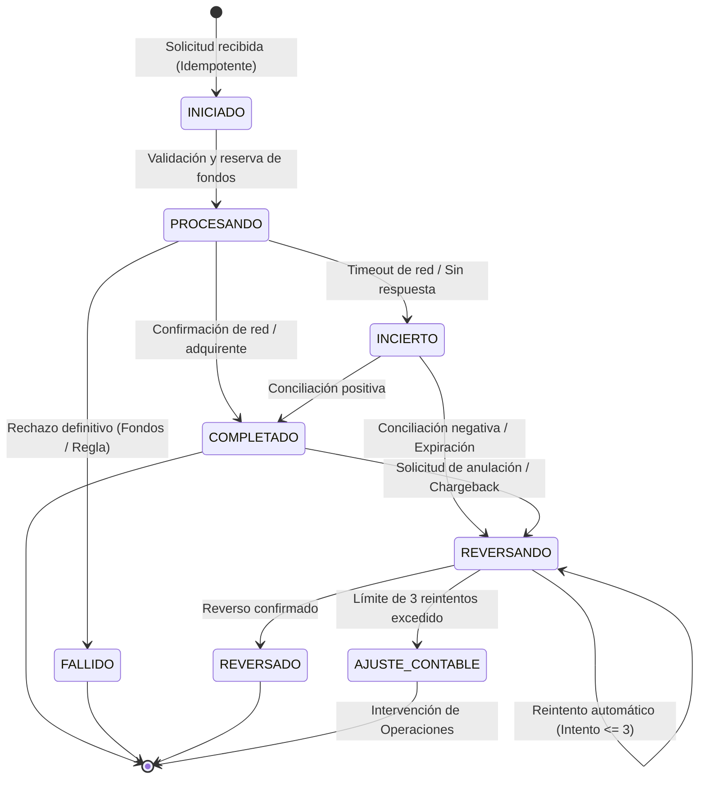

# Motor de Pagos y Conciliación Financiera en Tiempo Real

Sistema distribuido orientado a eventos diseñado para el procesamiento idempotente de transacciones, gestión de contabilidad de partida doble y cuadre automático de saldos en tiempo real. Construido bajo estricto apego a los estándares operativos, de auditoría y trazabilidad exigidos por las normativas financieras locales de la República Dominicana.

---

##  Stack Tecnológico Planificado

| Capa | Tecnología | Propósito Principal |
| :--- | :--- | :--- |
| **Backend Core** | Java 21, Spring Boot 3 | Lógica de negocio, hilos virtuales (Project Loom) y APIs RESTful. |
| **Mensajería & Eventos** | Apache Kafka | Bus de eventos asíncrono, desacoplamiento y garantías de entrega. |
| **Persistencia & Caché** | PostgreSQL, Redis | Almacenamiento ACID del libro mayor (Ledger) y llaves de idempotencia. |
| **Seguridad & IAM** | Keycloak (OAuth2 / OIDC) | Control de acceso basado en roles (RBAC) y autenticación de servicios. |
| **Frontend & Ops** | React, TypeScript | Consola operativa para monitoreo de transacciones y gestión de excepciones. |

---

## 🏗️ Arquitectura del Sistema (Visión General)

El sistema implementa **Arquitectura Hexagonal (Puertos y Adaptadores)** en cada microservicio. Esto aísla las reglas financieras críticas (el núcleo del dominio) de los detalles de infraestructura como bases de datos, brokers de mensajería o clientes HTTP externos, facilitando las pruebas unitarias puras y la evolución tecnológica.

### Flujo Desacoplado de Microservicios

1. **`payment-ingress-api`**: Puerta de entrada transaccional. Valida esquemas, aplica control de idempotencia en Redis mediante `Idempotency-Key` y publica la intención de pago en Kafka.
2. **`double-entry-ledger-service`**: Consumidor transaccional que ejecuta la máquina de estados y registra asientos contables inmutables (débito/crédito) en PostgreSQL bajo aislamiento estricto.
3. **`reconciliation-engine-worker`**: Motor asíncrono que cruza los eventos internos del ledger contra extractos o respuestas de redes externas/adquirentes para detectar discrepancias.
4. **`ops-monitoring-ui`**: Interfaz web para que el equipo de operaciones visualice el estado de los pagos, investigue transacciones atascadas y ejecute resoluciones manuales auditadas.

---

##  Máquina de Estados del Ciclo de Vida del Pago

El flujo transaccional está gobernado por una máquina de estados finita y determinista. *(El archivo fuente original en PlantUML se encuentra disponible en [`docs/diagrams/payment-state-machine.puml`](docs/diagrams/payment-state-machine.puml)).*

### Invariantes Financieras Clave

* **Aislamiento de Timeouts (`INCIERTO` vs `FALLIDO`):** Un *timeout* en una pasarela o red interbancaria nunca se asume como un fallo. Mover la transacción a `INCIERTO` congela el estado y evita devolver fondos al cliente cuando el cobro pudo haberse ejecutado en el destino, previniendo pérdidas financieras por doble gasto.
* **Límite Estricto de Reintentos en Reversos:** Las operaciones de compensación (`REVERSANDO`) tienen un tope máximo de **3 intentos** con *backoff* exponencial. Esto evita bucles infinitos que saturen los hilos de procesamiento o bloqueen cuentas ante caídas prolongadas de terceros.
* **Válvula de Escape (`AJUSTE_CONTABLE`):** Si un reverso falla tras agotar sus 3 reintentos, el sistema no descarta el error ni corrompe el balance; transiciona a `AJUSTE_CONTABLE`. Este estado terminal genera un asiento de discrepancia y alerta al equipo operativo para su resolución manual y trazable.
